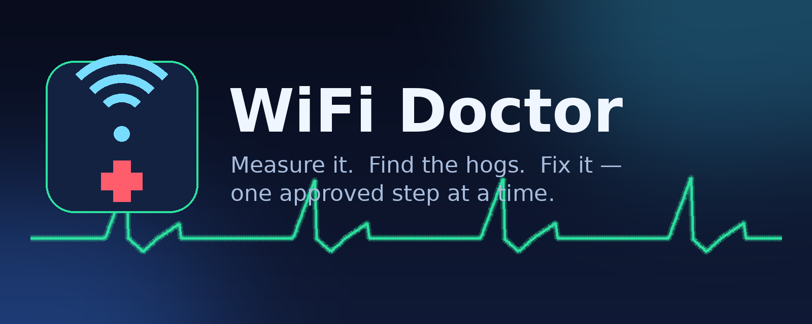
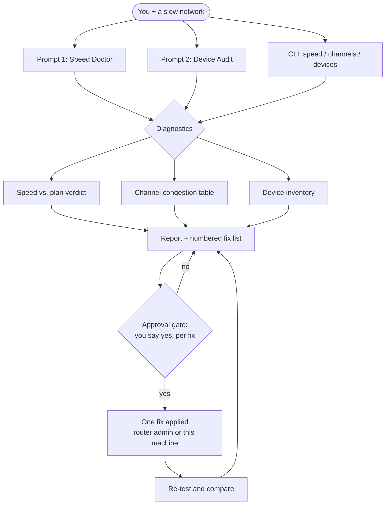
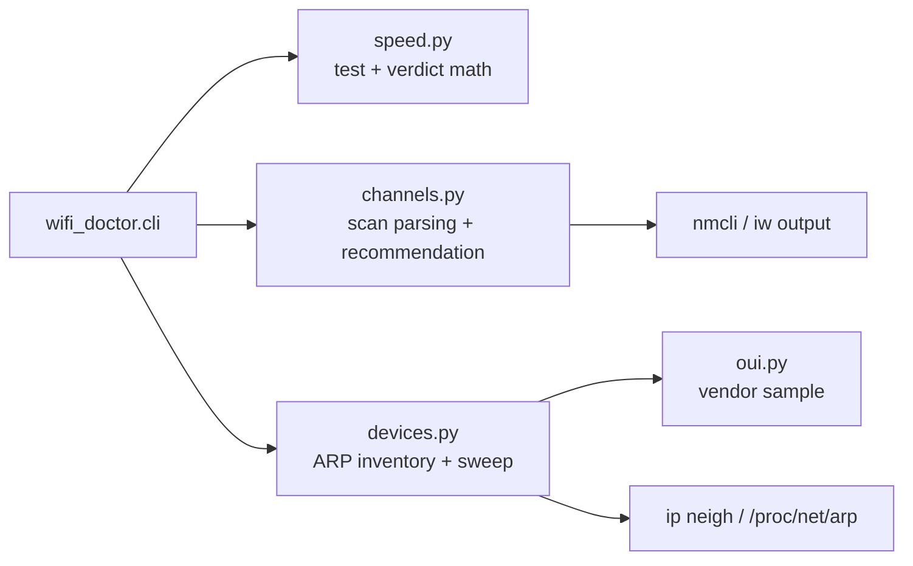

<p align="center">
  
</p>

<p align="center">
  
</p>

<h1 align="center">WiFi Doctor</h1>

<p align="center">
  <strong>Your WiFi is slow. Find out why — measure it against your plan, find the crowded channel, find the mystery devices — then fix it one approved step at a time.</strong>
</p>

<p align="center">
  <a href="LICENSE"></a>
  
  
  
  
  
</p>

---

## Contents

- [What it is](#what-it-is)
- [Why — the honest version](#why--the-honest-version)
- [Quick start](#quick-start)
- [The two prompts](#the-two-prompts)
- [CLI usage](#cli-usage)
- [How it works](#how-it-works)
- [Safety & approval gates](#safety--approval-gates)
- [Honest limits](#honest-limits)
- [Contributing](#contributing)
- [License](#license)

---

## What it is

WiFi Doctor is a home-WiFi diagnostic toolkit in two parts:

1. **Two copy-paste prompts for [Claude Code](https://claude.com/product/claude-code)** that do the full job — a speed diagnosis with an approval-gated fix list, and a complete device audit with router-level blocking guidance.
2. **A small, dependency-free Python CLI** that runs the local diagnostics itself: speed test vs. your plan, per-channel congestion, and a LAN device inventory.

The CLI only ever *looks*. It changes nothing. Anything that would change your network happens in your router admin — and the prompts walk you through those changes with an explicit approval step for every single one.

## Why — the honest version

This started as a viral reel format: *"paste this prompt into Claude Code and double your WiFi speed."* The format is great. The promise is not — **no prompt, tool, or AI can make your WiFi 10x faster.** Your plan speed is the ceiling.

What *is* real: most slow home WiFi has a boring, findable cause. A channel shared with six neighbours. A backup job eating your upload. A device on your network you don't recognize. WiFi Doctor keeps the reel's format — paste a prompt, get a diagnosis — and replaces the magic with measurement, an honest verdict, and fixes you approve one at a time.

## Quick start

```bash
git clone <this repo> && cd wifi-doctor

# Option A — the prompts (the full experience)
# Open one in your editor, fill in your plan speed, paste into Claude Code:
cat prompts/prompt-1-speed-doctor.md

# Option B — the CLI (no dependencies, Python 3.9+)
python3 -m wifi_doctor speed --plan 500     # speed test vs. your 500 Mbps plan
python3 -m wifi_doctor channels             # who is crowding which channel?
python3 -m wifi_doctor devices              # what's on my network?
```

## The two prompts

### 1 · Speed Doctor — [`prompts/prompt-1-speed-doctor.md`](prompts/prompt-1-speed-doctor.md)

> *"You are my WiFi speed doctor. Work through this in order, show me everything you find, and **never apply a fix without asking me first, one fix at a time.** … Run a real speed test … compare against my plan speed … find the channel fight … find the hogs … present a numbered fix list … apply, one at a time, with my OK."*

It runs a real speed test and compares it to your plan (healthy / below plan / far below plan), builds a per-channel congestion table, lists the background hogs on your machine, then proposes a numbered fix list — applying each fix **only after you say yes**, re-testing after each one. If it can't get into your router admin, it stops and gives you the exact clicks instead.

### 2 · Device Audit — [`prompts/prompt-2-device-audit.md`](prompts/prompt-2-device-audit.md)

> *"You are my home-network auditor. Build me a complete inventory of the devices on my local network, help me mark which ones are mine, and — only for the ones I say are unknown, and only with my explicit OK for each one — walk me through blocking them at the router."*

It inventories every device it can find (IP, MAC, vendor, hostname), presents them as a checklist for you to mark known/unknown, and for the unknowns gives the exact router-level blocking steps — plus how to undo every block, and the honest warning that MAC blocking is a speed bump and a changed WiFi password is the real fix.

## CLI usage

```
$ python3 -m wifi_doctor speed --plan 500
WiFi Doctor — speed test
Method: timed download of 25 MB from Cloudflare
Download: 412.6 Mbps
Plan:     500 Mbps  (83% of plan)
Verdict:  healthy — You are getting at least 80% of your plan speed on this device, right now.
```

```
$ python3 -m wifi_doctor channels
WiFi Doctor — channel congestion  (source: nmcli, 14 networks seen)

  CH  NETWORKS   LOAD  NETWORKS
   1         2    0.6  CoffeeDownstairs, FarAway
   6         3    1.9  HomeNet, NeighbourNet, PrinterNet
  11         1    0.7  Upstairs
  36         2    1.3  FiveGHome, FiveGNeighbour

Your network is on channel 6.
Least crowded 2.4 GHz channel: 1 (of 1/6/11, the non-overlapping set)
```

```
$ python3 -m wifi_doctor devices
WiFi Doctor — devices on this network

  #  IP               MAC                VENDOR                  HOSTNAME
  1  192.168.1.1      50:c7:bf:aa:bb:cc  TP-Link                 —
  2  192.168.1.42     b8:27:eb:11:22:33  Raspberry Pi            —
  3  192.168.1.77     18:fe:34:44:55:66  Espressif (IoT)         —

3 device(s). …
```

| Command | What it does | How |
|---|---|---|
| `speed [--plan Mbps]` | Speed test with a plan verdict (≥80% healthy, 50–80% below, <50% far below) | `speedtest-cli` if installed, else a timed 25 MB download from Cloudflare's test endpoint — method always printed; fallback is download-only |
| `channels` | Per-channel congestion table + least-crowded recommendation | Parses `nmcli dev wifi list` or an `iw` scan; strong neighbours weigh more; 2.4 GHz pick restricted to non-overlapping 1/6/11 |
| `devices [--sweep]` | LAN inventory: IP, MAC, vendor, hostname | ARP/neighbour table, optionally after a ping sweep of your /24; vendor from a small built-in OUI sample — a miss says "unknown vendor", never a guess |

Missing tools or no WiFi adapter? Every command says so in plain English and exits cleanly. No tracebacks, no invented results.

## How it works





## Safety & approval gates

These rules are written into both prompts and into the CLI's design:

- **Read-only by default.** The CLI has no code path that changes anything.
- **One fix at a time.** Every proposed change is shown exactly — setting, old value, new value — before it is applied, and each needs its own explicit yes.
- **Security settings are never touched silently.** WiFi password, encryption, firewall, remote admin, WPS: flagged and explained, changed only if you explicitly ask.
- **No admin access, no guessing.** If the router login isn't available, the prompts stop and hand you the manual steps. Admin passwords are never guessed.
- **Revert on regression.** If a fix makes things worse, it gets undone and reported, not buried.
- **Blocking is a router feature.** No laptop script can kick a device off your WiFi. The audit prompt says so, gives the router steps, and documents how to undo each block.

## Honest limits

- **Your plan is the ceiling.** Real gains come from channel moves, the 5 GHz band, pausing hogs, and router placement — not from any prompt.
- **A speed test measures one device, one moment.** A slow result can be the device, the walls, or the hour — not necessarily your ISP.
- **Congestion changes by the hour.** A channel scan is a snapshot.
- **Inventories are best-effort.** Sleeping or ping-shy devices may not appear; a vendor name is a hint from a MAC prefix, not an identity.
- **MAC blocking is a speed bump.** Addresses can be spoofed. A genuine stranger on your network means: change the WiFi password, use WPA2/WPA3.

## Contributing

Issues and PRs welcome — especially:

- A fuller OUI dataset (the built-in sample in `wifi_doctor/oui.py` is deliberately small)
- `iw`-scan fixtures from more chipsets and locales for the parser tests
- Windows/macOS equivalents for the `channels` and `devices` commands

Run the tests before submitting:

```bash
pip install pytest
python3 -m pytest tests/ -q   # 22 tests, fixture-driven, no network needed
```

## License

MIT — see [LICENSE](LICENSE).

---

<p align="center">
  Built by <a href="https://github.com/EdgeAgent">Edge Agency</a>.<br>
  ⭐ <strong>Star this repo if it saved you a call to your ISP</strong> — that's the whole point.
</p>
